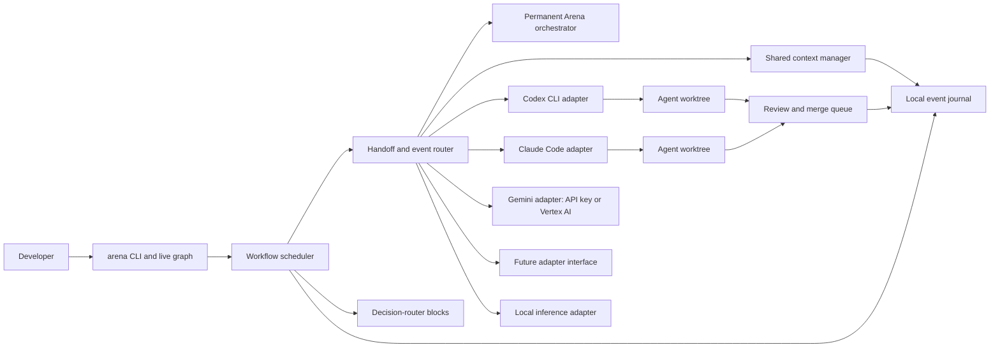

# Architecture

## Local control plane

Arena is the control plane around provider-owned agents. In the MVP it runs on the developer's machine and launches supported provider CLIs in controlled workspaces, uses approved provider integrations, or connects to supported same-machine local inference servers. Authentication stays in the provider's supported CLI or credential store; Arena does not capture or persist credentials.



## Components

- **CLI/TUI:** Creates and validates workflow graphs, starts and pauses runs, renders agent states and links, and provides history and rollback commands.
- **Provider status:** Probes required adapters without exposing credentials, reports CLI/version and compatible authentication readiness, and lists models/effort values and skill discovery only when the adapter can verify them.
- **Bootstrap flow:** `arena init` installs the skill in the selected provider's documented project skill location, asks for the default provider/model/effort if missing, and launches a guided conversation through that provider CLI. The model uses CLI operations to create workflows and profiles. It asks the user for missing required choices instead of filling them with assumptions. If the selected provider cannot load the skill or use Arena's supported CLI operations, initialization explains the limitation and asks the user to choose a compatible option.
- **Permanent Arena orchestrator:** A project-level on-call control agent using the configured default model and `arena-orchestrator` skill. It is available across workflow runs to process structured coworker requests, inspect current workflow state, and propose validated CLI changes. The workflow's user-selected head agent remains separate.
- **Workflow loader:** Loads `.arena/<id>.arena.json` and its referenced profiles, validates schema versions, team membership, on-call triggers, and graph invariants, and reports actionable errors.
- **Scheduler:** Starts eligible path nodes, composite teams and fan-out nodes, respects level/dependency rules and concurrency limits, pauses the run for a decision when an optional token or minutes budget is reached, runs team consensus rounds and capped fan-outs, matches on-call events, handles retries and cancellation, and tracks run state.
- **Decision routers:** Evaluate a configured JSON Pointer against a structured packet and take one exact-match branch or the declared fallback. They are graph blocks with no model process, worktree, or provider identity.
- **Provider adapters:** Translate a normalized task envelope into the provider CLI or local inference backend's supported invocation and translate its result into a normalized completion. Each adapter declares model selection, streaming, permissions, cancellation, and readiness capabilities.
- **Local inference adapter:** Connects to a same-machine supported model backend, verifies the requested model, and exposes only the tool, streaming, and reasoning controls the backend actually supports.
- **Message router:** Persists and delivers task, result, question, and peer-message envelopes. Agents communicate through Arena; no cross-provider session sharing is assumed.
- **Shared context manager:** Serves durable per-workflow context entries across runs, accepts typed agent proposals, enforces project policy and size limits, and versions every mutation.
- **Terminal layout:** Renders the A2rena wordmark, required-provider status, live graph, packet activity, and a colored Git worktree tree while adapting to terminal dimensions.
- **Workspace manager:** Creates one Git worktree per writing agent/task, tracks branch, base commit, and gitdir, captures checkpoints, and prepares changes for integration. It runs host Git on worker worktrees only through the recorded gitdir with executable config disabled, and rejects a worktree whose `.git` was replaced (see [Audit and rollback](AUDIT-AND-ROLLBACK.md#host-git-on-worker-worktrees)).
- **Integration manager:** Reviews changes in an Arena-owned queue, checks for conflicts and stale bases, and applies a selected change according to workflow policy.
- **Event journal:** Stores ordered state events and (according to retention settings) message bodies, process output, diffs, and checkpoint references under `.arena/.state/`.

The permanent orchestrator occupies a serialized project-level control slot in the on-call rail across every workflow. This slot is separate from the ordinary provider concurrency limit, so a requesting worker can await its control decision without holding the last available worker slot. Accepted coworker additions join an active run between scheduling waves; existing run roles and policy snapshots remain fixed. It is always available and wakes on a valid coworker request; it has no path edges. Arena displays its configured model and skill readiness. Agents submit coworker requests to the control plane; Arena applies the project `arena-subagent-modification-inquiry` policy before the orchestrator can add a profile or node. Accepted changes are a validated, reviewable config transaction with a journal entry and a reversible snapshot. `auto-accept` only applies to complete requests within project limits and supported adapter capabilities.

## Graph execution model

- **Level** controls the vertical grouping in the graph and the order in which the user expects work to progress. It is presentation and scheduling metadata, not a substitute for a relationship.
- **Delegation links** carry task assignments from a coordinator to workers, to a team group node or to a fan-out node. The delegation graph must be acyclic; the only back edges are capped router loop routes. A declared fan-out node is the only run-time multiplication of agent instances; the graph itself never grows at run time except through an approved coworker addition.
- **Communication links** grant explicit message routes. They may be one-way or two-way, and can connect agents at the same level.
- **Return results** go back to the delegating agent by default. A worker may message another worker only when a communication edge permits it.
- **Teams** are composite execution nodes with at least two member agents and one facilitator. Arena gives each member the same scoped task, records independent positions, runs bounded deliberation rounds, and asks each member to affirm a final verdict. Only a shared final verdict is `consensus`; otherwise Arena returns one `no-consensus` team result with the positions and dissent preserved. An unavailable member prevents consensus. It never labels a majority vote as consensus. Reaching a team node makes its members reachable for graph validation; members cannot also be reached as standalone path targets.
- **Fan-out nodes** own a planner agent and a worker template, both at the node's level and outside ordinary edges, like team members. The planner runs read-only and returns a list of work items; after the user approves the list (or immediately, for `auto-within-cap` when it fits), Arena starts one copy of the worker per item, named `<fanOutId>.<n>`, at most `maxChildren` and never past the project's per-run `maxFanOutChildrenPerRun`. Each child is an ordinary agent invocation with its own worktree, both concurrency layers and the integration queue. Children are recorded in the run, not the workflow, so the validated graph and the arena grade stay static. The node returns one `fanout-result` packet whose change IDs pin the proposal of every child that does not overlap a sibling; before returning, Arena checks child pairs with `git apply --check`, marks overlapping children `conflict` and journals `fanout.conflict`, keeps their changes as separate proposals and leaves them out of the next node's base, so a conflict is surfaced instead of failing the run. A failed child does not stop its siblings; the node fails only if the planner fails, the user stops the plan, or every child fails.
- **On-call agents** are excluded from ordinary delegation and communication edges. Their trigger rules subscribe to supported run events or a developer's manual invocation. Arena starts them only when a rule matches, supplies the triggering event and allowed context, then routes their result to the event's originating task or the head agent. On-call invocations count against a per-run cap and use the same worktree, permissions, and audit rules as other agents.
- **Decision routers** accept structured packets from incoming delegation edges. Each route compares one named payload field to an exact scalar value and points to an agent, team, or another router. An unmatched packet, missing field, or wrong kind follows an explicit `ask-user`, `stop`, or fallback-route action. Branch edges participate in reachability and acyclicity checks. A route marked `loop` with `maxIterations` is the exception: it may send the packet back to an ancestor, which restarts that part of the graph in new worktrees until the cap, then the fallback applies. Routers never interpret free-form prose or silently discard a packet.
- **Local model agents** are ordinary agent nodes with provider ID `local` and a selected backend such as Ollama, LM Studio, llama.cpp, vLLM, or a local OpenAI-compatible server. They use the same message router, concurrency limit, worktree, integration queue, context, and audit trail as other agents. The MVP local adapter targets loopback services on the developer's machine.
- **Read-only agents** can share the caller's base revision or a read-only snapshot. Any agent that writes gets its own worktree.

The graph renders each team as a single connected group node with its member agents nested inside or shown on expansion. A fan-out renders as one card with its planner, worker and cap, then its approval state, how many approved children have finished and how many conflict; children have no cards of their own. On-call agents appear in a separate rail, with trigger badges and event links shown only when they fire. Neither member containment nor an event trigger is drawn as a normal delegation arrow.

## Team coordinator

The team coordinator owns the deliberation state machine. Every round and member position is an auditable event. Member messages use the common envelope and are scoped to the team's task, not to an assumed shared provider session. The facilitator is a member of the team and uses a separate read-only snapshot to compose the final `arena.team-verdict.v1` packet only after all members affirm the same configured verdict. If members still disagree at `maxRounds`, the facilitator emits a packet with `outcome: "no-consensus"`, a null verdict, the final positions, and an explicit next action. The caller must handle both outcomes.

Team settings define the available verdict labels and round limit. The first protocol version uses unanimous agreement; quorum or majority modes would need a separately named outcome and must not be presented as consensus.

## On-call event router

The event router matches the run journal against a workflow's on-call rules. Initial event triggers are team no-consensus, agent failure, validation failure, and changed paths matching configured patterns; the developer can also invoke an on-call agent manually. An event-triggered call receives the event ID, source, concise task context, and file/workspace policy. Arena deduplicates delivery by event and agent, enforces `maxInvocationsPerRun`, and records unmatched or capped triggers so the live graph explains why a specialist did or did not run.

On-call nodes have no path level and cannot be a head agent, team member, or endpoint in ordinary relationships. They may be writing agents; writable calls receive a dedicated worktree and still enter the integration queue.

The live graph is a view of scheduler and journal events. It must not be a second source of truth.

The shared context manager is the only writer for agent context changes. It serializes proposals from separate worktrees, records provenance and policy decisions, and preserves prior versions for rollback. Each workflow's context is isolated by workflow ID; only the active workflow's relevant entries are offered to its agents. See [Shared context](SHARED-CONTEXT.md).

## Adapter contract

Every adapter exposes a capability description before launch:

```text
provider id and adapter version
readiness check that does not reveal credentials
supported invocation mode and streaming format
model selector behavior
provider-specific effort/reasoning options
permission mode and workspace boundary behavior
cancel/timeout behavior
normalized result and failure mapping
```

The scheduler may only request capabilities the adapter declares. If an adapter cannot enforce a required workspace or permission policy, Arena must refuse that workflow configuration or explain the limitation before launch.

### Mediated command sandbox

Adapters that use Arena's mediated tool protocol (Claude, Gemini and local models) run `run_command` inside an OS sandbox: bubblewrap on Linux and `sandbox-exec` on macOS. There is no unsandboxed fallback. Codex uses its own native sandbox instead. Command output goes back to the model and so to its provider, so the sandbox limits what a command can read as well as what it can write.

- **Reads** are limited to an allowlist:
  - system toolchain roots: `/usr`, `/bin`, `/sbin`, `/lib*`, `/etc`, `/opt` and `/nix/store` on Linux; `/usr`, `/bin`, `/sbin`, `/System`, `/Library`, `/opt`, `/private/etc`, Xcode and a few `/private/var/db` system databases on macOS;
  - the assigned worktree;
  - the command's private scratch directory;
  - read-only toolchain directories: the requested executable's directory, GOROOT, the Go module cache, and absolute `PATH` entries outside the home directory.

  A toolchain directory is dropped if it is `/`, contains or equals the home directory, is an ancestor of the worktree (which would expose sibling worktrees and `.arena/.state`), or has an Arena control or credential component such as `.arena`, `.git`, `.ssh` or `.aws`. On Linux, sensitive `/etc` entries (`shadow`, `sudoers`, `ssh`, `ssl/private` and network secrets) are masked. On macOS, `/Library/Keychains` and similar files are denied. File metadata (`stat`) stays allowed on macOS so paths can be resolved.
- **Not readable:** host home directories (dotfiles, provider auth files, SSH and cloud credentials), other worktrees and Arena state, the global temporary directory, `/run`, and the repository's Git directory. Because the Git directory is hidden, Git commands inside the sandbox fail, and Go builds run with `GOFLAGS=-buildvcs=false`.
- **Processes:** On Linux, commands run in a new PID namespace with a fresh `/proc`, so other processes' command lines and environments are not visible.
- **Writes** are limited to the worktree (only for writing agents), the private scratch directory and `/dev/null`.
- **Network:** All networking is denied.
- **Environment:** Commands receive only `PATH`, locale and `TERM` from the host. `HOME`, `TMPDIR`, XDG cache and Go build caches point into the scratch directory, which is removed after the command finishes. Each command times out after two minutes.

Toolchains installed under the home directory (for example rustup or nvm) are not readable unless invoked directly by absolute path, and then only their own directory is exposed. Dependencies must be prepared outside the run. The macOS profile mirrors the Linux boundary but has not been exercised on a macOS host in this change.

## State and storage

```text
.arena/
  settings.arena.json
  <workflow-id>.arena.json
  .agents/arena-system/arena-orchestrator.agent.json
  .agents/<workflow-id>/<agent-id>.agent.json
  context/<workflow-id>/entries/<entry-id>.context.json
  .state/<run-id>/events.ndjson
  .state/<run-id>/messages/<message-id>.json
  .state/<run-id>/checkpoints/...
  .state/context/<workflow-id>/entries/... # when configured local-only
```

Definitions, project settings, and profiles are portable and may be committed. Run data is local, ignored by Git by default, and excluded from remote synchronization. Share codes (`arena share`, `/copy`) export an arena's definition, profiles and shader, never run data or shared context, and every import is previewed and validated before it is saved. Keep provider secrets out of all these files. See [Configuration format](CONFIGURATION.md) and [Audit and rollback](AUDIT-AND-ROLLBACK.md).

The terminal's Git tree shows active branches and worktrees for the loaded arena, with stable agent colors. The status row probes only providers used by that arena and its permanent control agent. The graph and packet animation are projections of journaled events; their layout and small-terminal behavior are defined in [Terminal interface](TERMINAL-UI.md).

## Failure handling

- A provider process crash marks the node failed and records exit information; it does not silently reassign the task.
- Retry requires an idempotency decision from the scheduler. A retry is a new attempt linked to the prior event history.
- A user cancellation stops new work first, then requests cancellation from active adapters, checkpoints writable worktrees, and records any process that did not stop cleanly.
- A missing adapter feature, invalid auth state, or unsupported model selector is surfaced before task launch.
- A corrupt or unsupported journal is preserved and reported; Arena does not silently truncate it.

## Graph shader presentation

`internal/shader` compiles Arena's bounded HLSL profile into an immutable CPU
program. Uniforms are referenced lazily, and work that does not depend on the cell is
hoisted to once per frame. The TUI projects audited state into numeric uniforms:
counts, lifecycle flags, event ages, a focus position and envelopes eased on each
shader tick. The journal summary is cached until events change. Output becomes
ASCII luminance plus an optional softened hue, composed only outside protected
foreground spans.
Shader ticks are separate from journal polling, so an idle arena can animate
without inventing a run. Invalid source disables decoration with a diagnostic.
`arena shader` owns per-workflow source/settings transactions; model-generated
source is returned as data by the default orchestrator runtime and validated
before application. See [Background Shader Creation](BACKGROUND-SHADERS.md).
