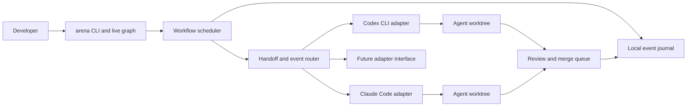

# Architecture

## Local control plane

Arena is the control plane around provider-owned agents. In the MVP it runs on the developer's machine and launches each supported provider CLI as a child process in a controlled workspace. Authentication remains in the provider CLI's own local sign-in store.



## Components

- **CLI/TUI:** Creates and validates workflow graphs, starts and pauses runs, renders agent states and links, and provides history and rollback commands.
- **Workflow loader:** Loads `.arena/<id>.arena.json` and its referenced profiles, validates schema versions and graph invariants, and reports actionable errors.
- **Scheduler:** Starts eligible nodes, respects level/dependency rules and concurrency limits, handles retries and cancellation, and tracks run state.
- **Provider adapters:** Translate a normalized task envelope into the provider CLI's supported invocation and translate its result into a normalized completion. Each adapter declares model selection, streaming, permissions, cancellation, and authentication readiness capabilities.
- **Message router:** Persists and delivers task, result, question, and peer-message envelopes. Agents communicate through Arena; no cross-provider session sharing is assumed.
- **Workspace manager:** Creates one Git worktree per writing agent/task, tracks branch and base commit, captures checkpoints, and prepares changes for integration.
- **Integration manager:** Reviews changes in an Arena-owned queue, checks for conflicts and stale bases, and applies a selected change according to workflow policy.
- **Event journal:** Stores ordered state events and (according to retention settings) message bodies, process output, diffs, and checkpoint references under `.arena/.state/`.

## Graph execution model

- **Level** controls the vertical grouping in the graph and the order in which the user expects work to progress. It is presentation and scheduling metadata, not a substitute for a relationship.
- **Delegation links** carry task assignments from a coordinator to workers. The delegation graph must be acyclic.
- **Communication links** grant explicit message routes. They may be one-way or two-way, and can connect agents at the same level.
- **Return results** go back to the delegating agent by default. A worker may message another worker only when a communication edge permits it.
- **Read-only agents** can share the caller's base revision or a read-only snapshot. Any agent that writes gets its own worktree.

The live graph is a view of scheduler and journal events. It must not be a second source of truth.

## Adapter contract

Every adapter exposes a capability description before launch:

```text
provider id and adapter version
readiness check that does not reveal credentials
supported invocation mode and streaming format
model selector behavior
provider-specific effort/reasoning options
permission mode and workspace boundary behavior
cancel/timeout behavior
normalized result and failure mapping
```

The scheduler may only request capabilities the adapter declares. If an adapter cannot enforce a required workspace or permission policy, Arena must refuse that workflow configuration or explain the limitation before launch.

## State and storage

```text
.arena/
  <workflow-id>.arena.json
  .agents/<workflow-id>/<agent-id>.agent.json
  .state/<run-id>/events.ndjson
  .state/<run-id>/messages/<message-id>.json
  .state/<run-id>/checkpoints/...
```

Definitions are portable and may be committed. Run data is local, ignored by Git by default, and excluded from remote synchronization unless a future explicit feature provides a reviewed export. Keep provider secrets out of all these files. See [Configuration format](CONFIGURATION.md) and [Audit and rollback](AUDIT-AND-ROLLBACK.md).

## Failure handling

- A provider process crash marks the node failed and records exit information; it does not silently reassign the task.
- Retry requires an idempotency decision from the scheduler. A retry is a new attempt linked to the prior event history.
- A user cancellation stops new work first, then requests cancellation from active adapters, checkpoints writable worktrees, and records any process that did not stop cleanly.
- A missing adapter feature, invalid auth state, or unsupported model selector is surfaced before task launch.
- A corrupt or unsupported journal is preserved and reported; Arena does not silently truncate it.
