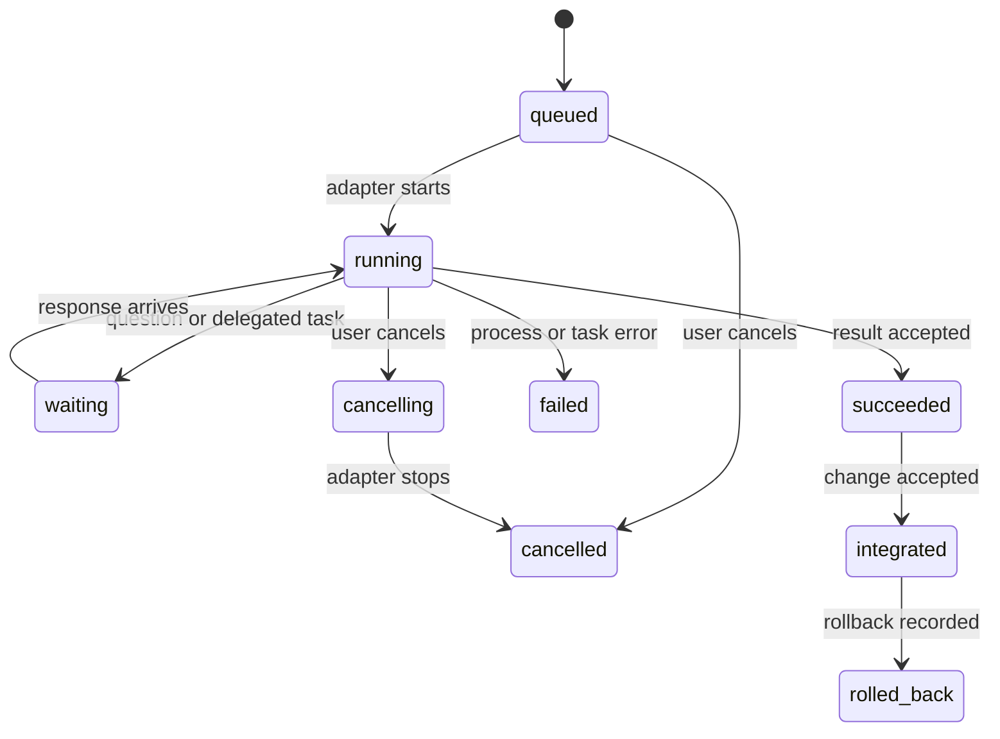

# Interoperability and handoffs

## Design rule

Agents from different providers do not share a native session or a common memory format. Arena is the broker for communication and workspace transitions. It passes explicit, versioned data packets through supported provider CLI interfaces and records the routing event.

The `arena-orchestrator` skill teaches agents how to use the CLI. It does not replace the router or grant provider capabilities.

## Common handoff envelope

Every task, question, result, team verdict, and peer message uses the same outer envelope. Provider-specific details remain in `providerContext` and are opaque to the shared protocol.

```json
{
  "protocolVersion": "1.0",
  "messageId": "msg_01J...",
  "runId": "run_01J...",
  "kind": "task",
  "from": { "agentId": "orchestrator", "provider": "codex" },
  "to": { "agentId": "researcher", "provider": "claude-code" },
  "createdAt": "2026-10-15T14:00:00Z",
  "correlationId": "task_01J...",
  "attemptId": "attempt_01J...",
  "replyTo": null,
  "payload": {
    "objective": "Inspect the authentication flow and report likely regression risks.",
    "acceptanceCriteria": ["Return actionable findings with file and line references."],
    "context": ["Review the current run's proposed auth changes."],
    "constraints": ["Do not modify files."],
    "files": ["src/auth/"],
    "expectedOutput": ["Findings with file and line references", "Open questions"],
    "workspace": { "baseCommit": "abc1234", "mode": "read-only" },
    "deadline": null
  },
  "providerContext": {
    "model": "sonnet",
    "reasoningEffort": null,
    "options": {}
  }
}
```

For a common interoperable record, implementations must preserve these fields:

- `protocolVersion`, unique `messageId`, `runId`, and `kind`.
- Sender/recipient agent IDs and provider IDs.
- Creation time, correlation ID, and optional reply reference.
- Unique attempt ID, objective, acceptance criteria, context, constraints, file references, expected output, and workspace base/mode.
- Provider context as an opaque object; adapters may add fields but must not reinterpret another provider's values.
- Optional `invocation` metadata identifies team-member work (`mode: "team-member"`, `teamId`) or on-call work (`mode: "on-call"`, trigger, trigger event ID, and source ID). Adapters preserve this metadata so agents and audit tools can distinguish how the task was routed.

Reviewer result messages, team result messages, coworker requests, and tasks with `invocation` metadata use protocol version `1.1` or newer. Shared-context proposals and results use protocol version `1.2` or newer. Unknown fields are preserved when forwarding. A reader that cannot understand a required protocol version or message kind must stop and report the incompatibility instead of dropping fields silently.

## Message kinds and lifecycle

`task`, `question`, `message`, `result`, `review-result`, `team-result`, `coworker-request`, `context-proposal`, `context-result`, `error`, and `cancel` are the initial kinds. The scheduler records state transitions separately from message bodies.



- A task result identifies completed work, files changed, commit/checkpoint references, validation performed, known limitations, and recommended next action.
- A question includes the missing decision and blocks only its own work item unless the scheduler has a dependency on it.
- A worker result returns to its delegator. Peer messages use declared communication links.
- Peers run concurrently. Over MCP, `arena_send` with kind `message` reaches a peer and `arena_inbox` with `newOnly` and `waitSeconds` (at most 120) blocks until an unseen message arrives, so an agent can wait for agreement before returning. A result returned first ends that agent's side of the conversation.
- Extra packets in a worker's result that cannot be delivered (an unlinked peer, invalid JSON, a refused proposal) are journaled as `packet.rejected` and skipped; the result itself still returns to the delegator and the run continues.
- A retry gets a new attempt ID and retains the same correlation ID.
- Delivery is at least once across process recovery; consumers deduplicate by `messageId`.
- Cancellation is a request with a recorded outcome. Arena does not claim a provider stopped until the adapter confirms process exit.

## Reviewer verdict contract

An agent whose role is `review` returns a `review-result` envelope with `format: "arena.review-verdict.v1"`. The standard outcomes are:

- `Approved`: no blocking issue remains; the caller may continue to its integration policy.
- `ChangesRequested`: the change can be reconsidered after the listed findings are addressed.
- `Deny`: the request or change is not acceptable under its stated scope or policy.
- `NeedsMoreInformation`: the reviewer cannot make a supported decision yet.

Every result includes a concise rationale, evidence-backed findings with severity and file/line references, open questions, and a next action. A review team uses the same labels as its member verdicts, then wraps the unanimous team decision in `arena.team-verdict.v1`. The team packet remains distinct from an individual review result.

Example review-result payload:

```json
{
  "format": "arena.review-verdict.v1",
  "outcome": "ChangesRequested",
  "summary": "Constrain the callback redirect target.",
  "rationale": "The current code accepts an untrusted destination.",
  "findings": [
    {
      "severity": "high",
      "file": "src/auth/callback.ts",
      "line": 42,
      "evidence": "The request parameter is passed to the redirect without validation.",
      "recommendation": "Allow only relative paths or an explicit host allowlist."
    }
  ],
  "openQuestions": [],
  "nextAction": "Validate the redirect target and request another review."
}
```

## Team deliberation and verdict packet

Arena launches each member of a team with the same objective, acceptance criteria, context, constraints, and workspace base. It collects each member's position in a structured response, then shares the team's positions for up to the configured number of deliberation rounds. The provider sessions remain separate; Arena carries only explicit messages between them.

Team protocol version `1.1` requires unanimity. Every member must affirm the same verdict from the team's configured list. Deliberation rounds collect positions only. When all positions match, a separate affirmation asks each member whether it accepts that candidate as the team's verdict (`acceptTeamVerdict`), which is distinct from approving the change: unanimous `ChangesRequested` is a consensus. A member that repeats the candidate but declines it is asked once more (journaled as `team.affirmation-clarified`); only explicit acceptance counts. The team result carries the change IDs of the inputs it reviewed as well as any member changes, so the agent a router sends it to starts from the reviewed code. The facilitator then emits one `team-result` envelope whose `payload` is the team's only output to its caller:

```json
{
  "teamId": "release-review",
  "format": "arena.team-verdict.v1",
  "outcome": "consensus",
  "verdict": "ChangesRequested",
  "summary": "The patch needs one authorization check before release.",
  "rationale": "Both reviewers found that the callback accepts an unvalidated redirect target.",
  "evidence": ["src/auth/callback.ts:42"],
  "memberPositions": [
    { "agentId": "reviewer", "verdict": "ChangesRequested", "status": "affirmed", "summary": "Validate redirect targets.", "evidence": ["src/auth/callback.ts:42"] },
    { "agentId": "security-reviewer", "verdict": "ChangesRequested", "status": "affirmed", "summary": "The redirect target is not constrained.", "evidence": ["src/auth/callback.ts:42"] }
  ],
  "dissent": [],
  "rounds": 1,
  "nextAction": "Validate the redirect target, then request a fresh review."
}
```

The same packet shape is returned when the members cannot agree. In that case `outcome` is `no-consensus`, `verdict` is `null`, and `dissent` explains the unresolved positions. This is not approval and must not be collapsed to a majority verdict. Downstream agents can branch on the stable `format` and `outcome` fields. Arena journals each member position, deliberation round, facilitator synthesis, and final packet; the packet itself does not include hidden chain-of-thought.

Before delivery, Arena checks that every configured member appears once, every verdict is allowed by the team's output contract, and a consensus packet records unanimous final affirmation of the same verdict. A member that cannot return a final position is marked `unavailable`; that prevents consensus and is included in `dissent`. A provider process failure is also recorded as an agent failure and can trigger on-call routing. The JSON Schema describes the packet shape; these workflow-aware checks are enforced by the runtime.

## Decision routers

A decision-router block consumes a structured envelope kind and reads one JSON Pointer relative to its `payload`. It compares the resulting scalar to configured exact-match values and routes the original packet along the matching branch. For example, a router may inspect `/outcome` from `review-result` and branch on `Approved`, `ChangesRequested`, or `Deny`. It does not invoke a model or infer a value from prose.

Every router has an explicit fallback for an unrecognized packet kind/value or missing field: ask the user, stop the path with a recorded unhandled outcome, or route to a configured fallback node. Workflow validation requires unique match values, valid branch targets, and an acyclic graph including all conditional branch edges, except for explicitly capped loop routes (below). A selected branch records the source packet ID, field value, rule ID, target, and fallback decision when applicable. It passes the packet and its provenance to the target agent or team.

Example router definition:

```json
{
  "id": "review-gate",
  "name": "Review gate",
  "inputKind": "review-result",
  "payloadPointer": "/outcome",
  "routes": [
    { "id": "approved", "equals": "Approved", "to": "integrator" },
    { "id": "changes-requested", "equals": "ChangesRequested", "to": "implementer", "loop": true, "maxIterations": 2 },
    { "id": "denied", "equals": "Deny", "to": "request-owner" }
  ],
  "fallback": { "action": "ask-user" }
}
```

### Loop routes

A route with `"loop": true` is the only permitted back edge. It must set `maxIterations` (1-5) and its `to` must be an ancestor of the router: a node that reaches the router through forward edges, such as the implementer whose work the reviewers examined. Loop routes are excluded from the cycle check; every other cycle is rejected.

When a loop route matches and fewer than `maxIterations` revisions have run for that router and target, Arena journals `loop.iteration` (router, route, target, iteration, cap, the restarted nodes and the feedback packet IDs) and starts the next pass of the loop body: every node reachable from the target through forward edges is reset to pending and runs again. Nodes outside the body, such as a tester that feeds the same review team, keep their earlier result. The target receives its original parent packets plus an Arena note and the routed verdict packet (for a team, the `team-result` with `memberPositions` and `dissent`). Agents in later passes get iteration-suffixed task IDs and worktrees (`implementer-iter2`) whose base includes the change IDs the verdict carried, so a revision builds on the reviewed change and records it as a dependency; the earlier proposal stays in the integration queue. The restart waits until nothing in the body is still running.

When the cap is spent, the matching value is treated as unmatched: Arena journals `loop.capped` and applies the router's fallback (`ask-user` no longer offers the capped target). The terminal graph draws a loop route as a side return edge labelled with the used and allowed revisions, for example `↺ 1/2`.

The `to` values refer to existing agent, team, or router IDs in the same arena. On-call agents are not valid path targets; use an event trigger to invoke them.

## On-call invocation

On-call agents are not reachable by ordinary graph edges. Arena's event router matches their configured triggers and sends a normal `task` envelope whose context identifies the trigger event, originating task, and permitted files/workspace. Initial automatic events are `team.no-consensus`, `agent.failed`, `validation.failed`, and `change.touches-paths`; a user can also invoke one manually. The router deduplicates an agent/event pair and enforces the workflow's per-run invocation limit.

An on-call response returns to the task that produced the trigger, or to the head agent if the source task has ended. If a configured rule is capped, duplicate, or ineligible, the journal records that result and the live view shows why no agent started. On-call work follows the same read/write permission, worktree, review, retention, and rollback policy as path work.

The task envelope identifies the route, rather than relying on a prompt convention:

```json
{
  "mode": "on-call",
  "trigger": "team.no-consensus",
  "triggerEventId": "evt_01J...",
  "sourceId": "release-review"
}
```

For a manual invocation, `sourceId` identifies the user and Arena still records a trigger event ID. For an internal team-member task, `invocation` is `{ "mode": "team-member", "teamId": "release-review" }`.

## Coworker requests

An active agent can ask for another agent through `arena agent request <workflow-id>`. The request is a `coworker-request` envelope addressed to the Arena control plane (`to.provider: "arena"`, `to.agentId: "arena-orchestrator"`). Arena records the request and wakes the permanent orchestrator using the project's default model; the request does not create a provider process or edit configuration by itself. The envelope includes the target workflow, requesting agent/run, role, objective, provider, model, reasoning effort (or explicit `null` when that provider has no such control), required capabilities, workspace scope, files, and reason for the coworker.

The request payload must be complete before it is submitted. When the provider has a reasoning control, a missing effort is a clarification request, not an invitation to copy the default model's effort. For providers without that control, the request includes `reasoningEffort: null`.

Example coworker request payload:

```json
{
  "workflowId": "code-review",
  "role": "test-engineer",
  "objective": "Add focused regression coverage for the changed authentication behavior.",
  "runtime": {
    "provider": "claude-code",
    "model": "sonnet-5.5",
    "reasoningEffort": "medium"
  },
  "capabilities": ["read", "write", "run_commands"],
  "workspaceMode": "write",
  "files": ["src/auth/", "tests/auth/"],
  "reason": "The implementation and review agents identified a regression path that needs an isolated test change."
}
```

The orchestrator applies `approvalPolicies.arena-subagent-modification-inquiry` before using CLI operations to create anything:

- `auto-refuse` records a refusal for workflow-agent requests without prompting the user.
- `ask-user` presents the complete proposal and waits for the user's decision.
- `auto-accept` applies a complete proposal only when provider readiness, project limits, graph validation, and adapter capability checks pass.

If a request is missing a required value, the orchestrator asks the user for it instead of inventing it, except when `auto-refuse` has already declined that agent-originated request. A direct request from the user to create an agent always gets clarification when required details are missing. All accepted changes are written through the CLI as a reversible configuration transaction.

## Shared-context packets

Agents from any provider use the same Arena context API for durable workflow knowledge. They can search/read entries and submit a `context-proposal`; they do not write context files from their provider worktree. A proposal uses `operation: "add"`, `"revise"`, or `"archive"`. Add/revise proposals include a title, concise content, tags, confidence, and evidence. Revise/archive also identify the entry. The outer envelope records the provider and run; the context manager adds actor, timestamps, and entry version metadata.

The context manager applies `sharedContext.agentWritePolicy` to additions/revisions and `sharedContext.agentDeletePolicy` to archive requests. Its `context-result` response uses `format: "arena.context-result.v1"` and one of `accepted`, `needs-user`, `refused`, or `not-found`. Only `accepted` mutates the store. Accepted changes are serialized, retain prior versions, and are recoverable through Arena rollback. Each workflow's entries are visible only in that workflow's context scope; packet routing does not grant cross-workflow access.

Example add proposal payload:

```json
{
  "workflowId": "code-review",
  "operation": "add",
  "entryId": null,
  "title": "Review verdicts require file evidence",
  "content": "Each finding should cite the affected file and the evidence supporting the verdict.",
  "tags": ["review", "evidence"],
  "confidence": "verified",
  "evidence": [
    { "kind": "file", "reference": "docs/INTEROPERABILITY.md", "note": "Reviewer verdict contract" }
  ]
}
```

Context entries are not transcripts. Agents must preserve uncertainty in the confidence field, cite supporting evidence, and never submit credentials, secrets, hidden reasoning, or unrelated conversation history. See [Shared context](SHARED-CONTEXT.md) for storage, retention, and user commands.

## Handoff content

Each handoff should contain enough information to continue without access to the sender's hidden conversation:

1. Objective and acceptance conditions.
2. Relevant repository state: base commit, worktree path, and changed files or read-only paths.
3. Decisions already made and the evidence behind them.
4. Validation run and its result, if any.
5. Constraints, risks, and unresolved questions.
6. Exact expected response format.

Do not pass hidden chain-of-thought. Pass concise findings and evidence instead. Store the user's task and agent messages according to the selected local audit retention policy; make redactions explicit in the event record.

## Cross-provider data boundary

When Arena forwards a task, selected context and file contents may be sent to the recipient provider for inference. The live view must show the destination provider before launch, and the workflow builder should let the user constrain which files or context may cross that boundary. Team membership permits sharing structured positions and evidence among those members, but does not expand the source task's file scope. Do not silently forward full conversation history or unrelated files. A configured communication edge permits routing; it does not imply that every file in the repository should be attached.

## Provider and model mapping

Provider identifiers are stable adapter IDs such as `codex`, `claude-code`, `gemini`, and `local`. Model IDs and effort labels are provider-defined strings. The UI may display them, but it must not claim that two providers' `high` settings mean the same thing. Missing or unsupported options are rejected or omitted with a clear notice; never silently substitute a different model.

## Local model agents

A local agent is a regular workflow agent with `provider: "local"`, an explicit model ID, and an explicit backend such as `ollama`, `lm-studio`, `llama.cpp`, `vllm`, or `openai-compatible`. It uses the same versioned task/result/review/team/context packets as other agents. Arena identifies it as `local` plus its backend/model in the UI, and `arena status` checks the local model server only when the loaded arena requires it. An adapter reports model availability and actual capabilities; it does not assume support for tools, streaming, or reasoning effort based on another provider's behavior.

The MVP local adapter connects only to same-machine loopback services. It does not send prompts to a hosted provider or use a consumer subscription. The local model process still receives the task scope and workspace permissions selected for its agent, and any writes stay in that agent's isolated worktree. A remote self-hosted endpoint is a separate integration and must not be presented as local.

## Authentication and subscription handling

Use the provider's supported local sign-in or an approved integration, such as the configured Gemini API-key or Vertex AI route. The CLI checks readiness without reading or displaying secrets. Arena stores no passwords, session cookies, API-key values, or reusable provider tokens and does not relay credentials between agent processes.

Provider plans, supported integrations, and terms change. Release checks must verify the exact supported sign-in and automation path. For OpenAI, an integration that uses ChatGPT plan usage must follow [Sign in with ChatGPT terms](https://openai.com/policies/sign-in-with-chatgpt-terms/) and current [partner-app guidance](https://help.openai.com/en/articles/20001542-using-your-chatgpt-plan-in-other-apps-and-sites), including user authorization and app-specific use. For Claude Code, use Anthropic's [documented setup and authentication options](https://docs.anthropic.com/en/docs/claude-code/getting-started). Gemini CLI's published FAQ says third-party tools must not harvest or piggyback on its OAuth session; it points third-party coding agents to Vertex AI or Google AI Studio API keys. Arena must therefore reject Gemini CLI OAuth as an Arena-managed auth path and guide setup only through a currently approved API-key or Vertex adapter. Do not infer that because a human can use a consumer plan in one CLI, a third-party scheduler may use it through any method.

## Current adapter references

- [Codex CLI](https://developers.openai.com/codex/cli/): consult the current CLI reference for supported local commands and options.
- [Claude Code CLI](https://docs.anthropic.com/en/docs/claude-code/cli-usage): documents non-interactive `-p` mode, structured output options, model selection, and turn limits.
- [Claude Code Agent Skills](https://code.claude.com/docs/en/skills): documents the portable `SKILL.md` format and Claude Code's project skill directory.
- [Gemini CLI installation](https://github.com/google-gemini/gemini-cli/blob/main/docs/get-started/installation.mdx) and [authentication setup](https://github.com/google-gemini/gemini-cli/blob/main/docs/get-started/authentication.mdx): use these to guide installation and the user-selected API-key or Vertex path; do not reuse Gemini CLI's personal OAuth session.
- [Gemini CLI Agent Skills](https://github.com/google-gemini/gemini-cli/blob/main/docs/cli/using-agent-skills.md): documents workspace skill discovery, including the shared `.agents/skills/` location.
- [Gemini CLI FAQ](https://github.com/google-gemini/gemini-cli/blob/main/docs/resources/faq.md): documents the restriction on third-party tools piggybacking on Gemini CLI OAuth and the API-key/Vertex alternatives.
- [Codex skills](https://developers.openai.com/codex/skills): documents repository discovery from `.agents/skills/`.

These links are release-time references, not promises that a command or feature will remain stable. Adapters must be version-aware and check supported behavior.

## Arena implementation extensions

The implementation preserves optional outer-envelope extensions. `arenaChangeIds`
identifies verified proposal artifacts needed by downstream workers; Arena composes
their pinned snapshot and records integration prerequisites. `arenaSourceProviders`
preserves provider provenance for a composite team result, so the synthetic `arena`
sender cannot bypass cross-provider context policy. `arenaRoutingInputs` is a local
router bundle containing the unchanged inputs selected for each downstream target.
These fields do not replace the versioned task/result contracts or reinterpret
provider options. An external reader may preserve extensions without executing them.

Team verdict prose is composed in a separate read-only snapshot. Writing members'
proposal IDs remain attached to the single team result, including no-consensus
results, so disagreement never discards their code.

## User attachments

Task payloads may include an optional `attachments` array of snapshot metadata:
`name`, `mediaType`, `size` (bytes), `sha256` and `file` (a path relative to that
run's state directory). This is an additive field in the version 1.2 envelope.
Original source paths and file bytes are not embedded in the envelope. Full-local
run manifests retain the same references; invocation verifies content hashes and
loads only that run's snapshots. Inputs remain separate from writable worktrees.
Attachment bytes are retained exactly, outside text secret-redaction, with private
file permissions; reduced-retention runs refuse attachments.

Codex receives images as native `image` data URLs and other files as explicitly
authorized snapshot paths. The mediated tool protocol exposes `read_attachment`
with an exact manifest `path`; it cannot open arbitrary paths. Unsupported image
adapters fail explicitly. The common envelope preserves metadata independently
of these provider-specific translations. Attachments follow the workflow's existing
handoff and cross-provider sharing policies.
