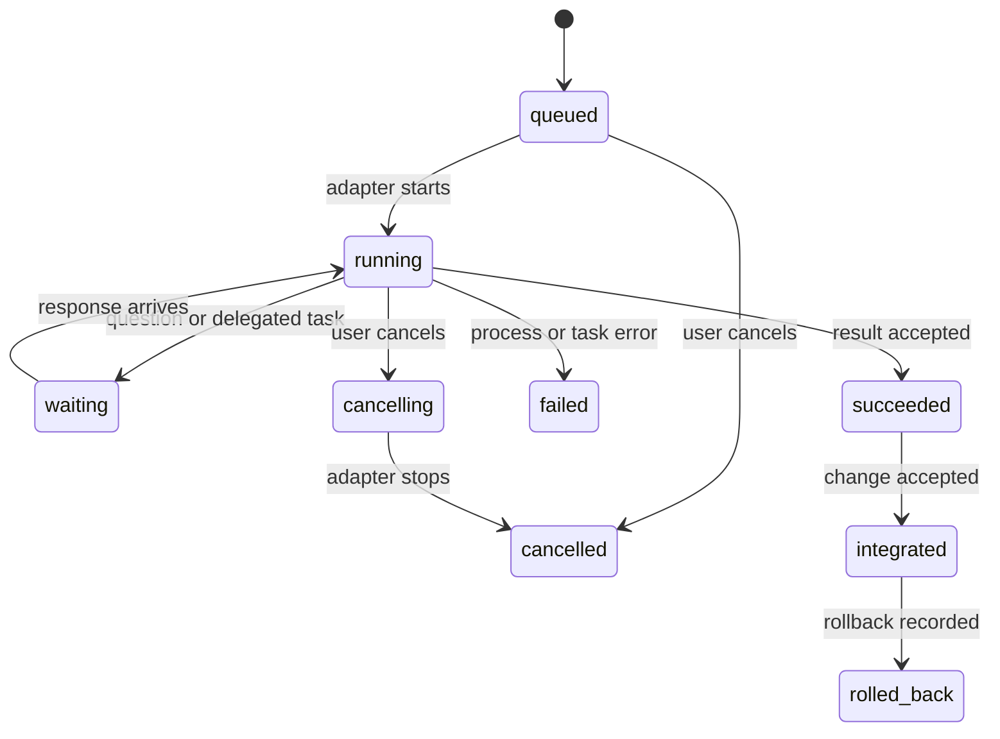

# Interoperability and handoffs

## Design rule

Agents from different providers do not share a native session or a common memory format. Arena is the broker for communication and workspace transitions. It passes explicit, versioned data packets through supported provider CLI interfaces and records the routing event.

The `arena-orchestrator` skill teaches agents how to use the CLI. It does not replace the router or grant provider capabilities.

## Common handoff envelope

Every task, question, result, team verdict, and peer message uses the same outer envelope. Provider-specific details remain in `providerContext` and are opaque to the shared protocol.

```json
{
  "protocolVersion": "1.0",
  "messageId": "msg_01J...",
  "runId": "run_01J...",
  "kind": "task",
  "from": { "agentId": "orchestrator", "provider": "codex" },
  "to": { "agentId": "researcher", "provider": "claude-code" },
  "createdAt": "2026-10-15T14:00:00Z",
  "correlationId": "task_01J...",
  "attemptId": "attempt_01J...",
  "replyTo": null,
  "payload": {
    "objective": "Inspect the authentication flow and report likely regression risks.",
    "acceptanceCriteria": ["Return actionable findings with file and line references."],
    "context": ["Review the current run's proposed auth changes."],
    "constraints": ["Do not modify files."],
    "files": ["src/auth/"],
    "expectedOutput": ["Findings with file and line references", "Open questions"],
    "workspace": { "baseCommit": "abc1234", "mode": "read-only" },
    "deadline": null
  },
  "providerContext": {
    "model": "sonnet",
    "reasoningEffort": null,
    "options": {}
  }
}
```

For a common interoperable record, implementations must preserve these fields:

- `protocolVersion`, unique `messageId`, `runId`, and `kind`.
- Sender/recipient agent IDs and provider IDs.
- Creation time, correlation ID, and optional reply reference.
- Unique attempt ID, objective, acceptance criteria, context, constraints, file references, expected output, and workspace base/mode.
- Provider context as an opaque object; adapters may add fields but must not reinterpret another provider's values.
- Optional `invocation` metadata identifies team-member work (`mode: "team-member"`, `teamId`) or on-call work (`mode: "on-call"`, trigger, trigger event ID, and source ID). Adapters preserve this metadata so agents and audit tools can distinguish how the task was routed.

Team result messages and tasks with `invocation` metadata use protocol version `1.1` or newer. Unknown fields are preserved when forwarding. A reader that cannot understand a required protocol version or message kind must stop and report the incompatibility instead of dropping fields silently.

## Message kinds and lifecycle

`task`, `question`, `message`, `result`, `team-result`, `error`, and `cancel` are the initial kinds. The scheduler records state transitions separately from message bodies.



- A task result identifies completed work, files changed, commit/checkpoint references, validation performed, known limitations, and recommended next action.
- A question includes the missing decision and blocks only its own work item unless the scheduler has a dependency on it.
- A worker result returns to its delegator. Peer messages use declared communication links.
- A retry gets a new attempt ID and retains the same correlation ID.
- Delivery is at least once across process recovery; consumers deduplicate by `messageId`.
- Cancellation is a request with a recorded outcome. Arena does not claim a provider stopped until the adapter confirms process exit.

## Team deliberation and verdict packet

Arena launches each member of a team with the same objective, acceptance criteria, context, constraints, and workspace base. It collects each member's position in a structured response, then shares the team's positions for up to the configured number of deliberation rounds. The provider sessions remain separate; Arena carries only explicit messages between them.

Team protocol version `1.1` requires unanimity. Every member must affirm the same verdict from the team's configured list. The facilitator then emits one `team-result` envelope whose `payload` is the team's only output to its caller:

```json
{
  "teamId": "release-review",
  "format": "arena.team-verdict.v1",
  "outcome": "consensus",
  "verdict": "request-changes",
  "summary": "The patch needs one authorization check before release.",
  "rationale": "Both reviewers found that the callback accepts an unvalidated redirect target.",
  "evidence": ["src/auth/callback.ts:42"],
  "memberPositions": [
    { "agentId": "reviewer", "verdict": "request-changes", "status": "affirmed", "summary": "Validate redirect targets.", "evidence": ["src/auth/callback.ts:42"] },
    { "agentId": "security-reviewer", "verdict": "request-changes", "status": "affirmed", "summary": "The redirect target is not constrained.", "evidence": ["src/auth/callback.ts:42"] }
  ],
  "dissent": [],
  "rounds": 1,
  "nextAction": "Validate the redirect target, then request a fresh review."
}
```

The same packet shape is returned when the members cannot agree. In that case `outcome` is `no-consensus`, `verdict` is `null`, and `dissent` explains the unresolved positions. This is not approval and must not be collapsed to a majority verdict. Downstream agents can branch on the stable `format` and `outcome` fields. Arena journals each member position, deliberation round, facilitator synthesis, and final packet; the packet itself does not include hidden chain-of-thought.

Before delivery, Arena checks that every configured member appears once, every verdict is allowed by the team's output contract, and a consensus packet records unanimous final affirmation of the same verdict. A member that cannot return a final position is marked `unavailable`; that prevents consensus and is included in `dissent`. A provider process failure is also recorded as an agent failure and can trigger on-call routing. The JSON Schema describes the packet shape; these workflow-aware checks are enforced by the runtime.

## On-call invocation

On-call agents are not reachable by ordinary graph edges. Arena's event router matches their configured triggers and sends a normal `task` envelope whose context identifies the trigger event, originating task, and permitted files/workspace. Initial automatic events are `team.no-consensus`, `agent.failed`, `validation.failed`, and `change.touches-paths`; a user can also invoke one manually. The router deduplicates an agent/event pair and enforces the workflow's per-run invocation limit.

An on-call response returns to the task that produced the trigger, or to the head agent if the source task has ended. If a configured rule is capped, duplicate, or ineligible, the journal records that result and the live view shows why no agent started. On-call work follows the same read/write permission, worktree, review, retention, and rollback policy as path work.

The task envelope identifies the route, rather than relying on a prompt convention:

```json
{
  "mode": "on-call",
  "trigger": "team.no-consensus",
  "triggerEventId": "evt_01J...",
  "sourceId": "release-review"
}
```

For a manual invocation, `sourceId` identifies the user and Arena still records a trigger event ID. For an internal team-member task, `invocation` is `{ "mode": "team-member", "teamId": "release-review" }`.

## Handoff content

Each handoff should contain enough information to continue without access to the sender's hidden conversation:

1. Objective and acceptance conditions.
2. Relevant repository state: base commit, worktree path, and changed files or read-only paths.
3. Decisions already made and the evidence behind them.
4. Validation run and its result, if any.
5. Constraints, risks, and unresolved questions.
6. Exact expected response format.

Do not pass hidden chain-of-thought. Pass concise findings and evidence instead. Store the user's task and agent messages according to the selected local audit retention policy; make redactions explicit in the event record.

## Cross-provider data boundary

When Arena forwards a task, selected context and file contents may be sent to the recipient provider for inference. The live view must show the destination provider before launch, and the workflow builder should let the user constrain which files or context may cross that boundary. Team membership permits sharing structured positions and evidence among those members, but does not expand the source task's file scope. Do not silently forward full conversation history or unrelated files. A configured communication edge permits routing; it does not imply that every file in the repository should be attached.

## Provider and model mapping

Provider identifiers are stable adapter IDs such as `codex` and `claude-code`. Model IDs and effort labels are provider-defined strings. The UI may display them, but it must not claim that two providers' `high` settings mean the same thing. Missing or unsupported options are rejected or omitted with a clear notice; never silently substitute a different model.

## Authentication and subscription handling

Use the provider's supported local sign-in or an approved integration. The CLI checks readiness without reading or displaying secrets. Arena stores no passwords, session cookies, or reusable provider tokens and does not relay credentials between agent processes.

Provider plans, supported integrations, and terms change. Release checks must verify the exact supported sign-in and automation path. For OpenAI, an integration that uses ChatGPT plan usage must follow [Sign in with ChatGPT terms](https://openai.com/policies/sign-in-with-chatgpt-terms/) and current [partner-app guidance](https://help.openai.com/en/articles/20001542-using-your-chatgpt-plan-in-other-apps-and-sites), including user authorization and app-specific use. For Claude Code, use Anthropic's [documented setup and authentication options](https://docs.anthropic.com/en/docs/claude-code/getting-started). Do not infer that because a human can use a consumer plan in one CLI, a third-party scheduler may use it through any method.

## Current adapter references

- [Codex CLI](https://developers.openai.com/codex/cli/): consult the current CLI reference for supported local commands and options.
- [Claude Code CLI](https://docs.anthropic.com/en/docs/claude-code/cli-usage): documents non-interactive `-p` mode, structured output options, model selection, and turn limits.
- [Claude Code Agent Skills](https://code.claude.com/docs/en/skills): documents the portable `SKILL.md` format and Claude Code's project skill directory.
- [Codex skills](https://developers.openai.com/codex/skills): documents repository discovery from `.agents/skills/`.

These links are release-time references, not promises that a command or feature will remain stable. Adapters must be version-aware and check supported behavior.
