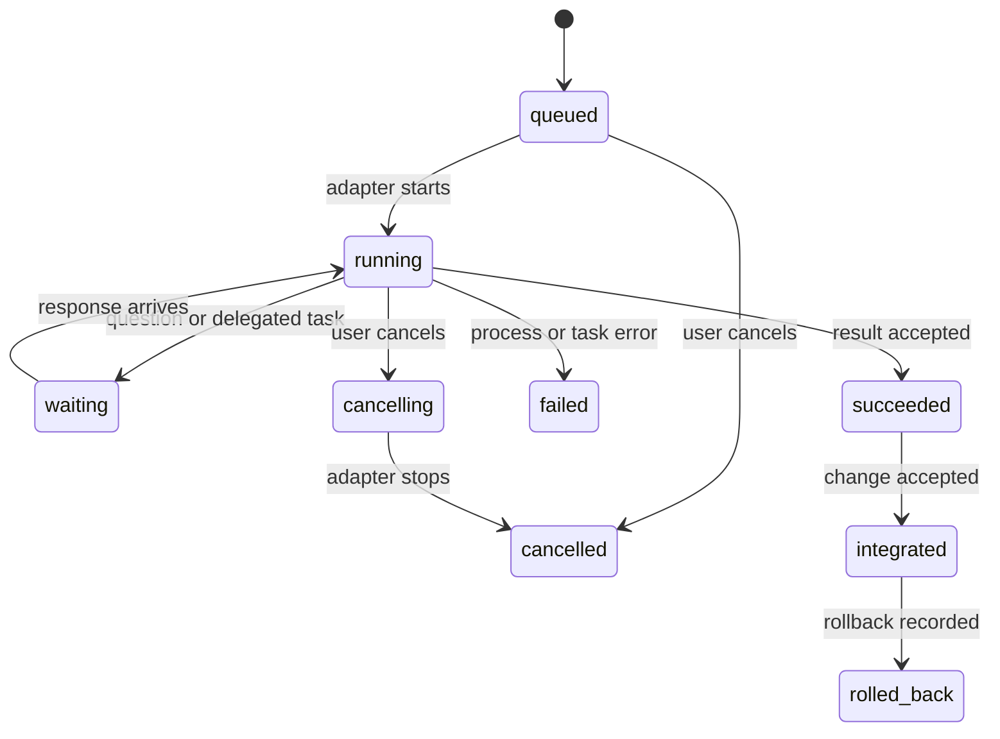

# Interoperability and handoffs

## Design rule

Agents from different providers do not share a native session or a common memory format. Arena is the broker for communication and workspace transitions. It passes explicit, versioned data packets through supported provider CLI interfaces and records the routing event.

The `arena-orchestrator` skill teaches agents how to use the CLI. It does not replace the router or grant provider capabilities.

## Common handoff envelope

Every task, question, result, and peer message uses the same outer envelope. Provider-specific details remain in `providerContext` and are opaque to the shared protocol.

```json
{
  "protocolVersion": "1.0",
  "messageId": "msg_01J...",
  "runId": "run_01J...",
  "kind": "task",
  "from": { "agentId": "orchestrator", "provider": "codex" },
  "to": { "agentId": "researcher", "provider": "claude-code" },
  "createdAt": "2026-10-15T14:00:00Z",
  "correlationId": "task_01J...",
  "attemptId": "attempt_01J...",
  "replyTo": null,
  "payload": {
    "objective": "Inspect the authentication flow and report likely regression risks.",
    "acceptanceCriteria": ["Return actionable findings with file and line references."],
    "context": ["Review the current run's proposed auth changes."],
    "constraints": ["Do not modify files."],
    "files": ["src/auth/"],
    "expectedOutput": ["Findings with file and line references", "Open questions"],
    "workspace": { "baseCommit": "abc1234", "mode": "read-only" },
    "deadline": null
  },
  "providerContext": {
    "model": "sonnet",
    "reasoningEffort": null,
    "options": {}
  }
}
```

For a common interoperable record, implementations must preserve these fields:

- `protocolVersion`, unique `messageId`, `runId`, and `kind`.
- Sender/recipient agent IDs and provider IDs.
- Creation time, correlation ID, and optional reply reference.
- Unique attempt ID, objective, acceptance criteria, context, constraints, file references, expected output, and workspace base/mode.
- Provider context as an opaque object; adapters may add fields but must not reinterpret another provider's values.

Unknown fields are preserved when forwarding. A reader that cannot understand a required protocol version must stop and report the incompatibility instead of dropping fields silently.

## Message kinds and lifecycle

`task`, `question`, `message`, `result`, `error`, and `cancel` are the initial kinds. The scheduler records state transitions separately from message bodies.



- A task result identifies completed work, files changed, commit/checkpoint references, validation performed, known limitations, and recommended next action.
- A question includes the missing decision and blocks only its own work item unless the scheduler has a dependency on it.
- A worker result returns to its delegator. Peer messages use declared communication links.
- A retry gets a new attempt ID and retains the same correlation ID.
- Delivery is at least once across process recovery; consumers deduplicate by `messageId`.
- Cancellation is a request with a recorded outcome. Arena does not claim a provider stopped until the adapter confirms process exit.

## Handoff content

Each handoff should contain enough information to continue without access to the sender's hidden conversation:

1. Objective and acceptance conditions.
2. Relevant repository state: base commit, worktree path, and changed files or read-only paths.
3. Decisions already made and the evidence behind them.
4. Validation run and its result, if any.
5. Constraints, risks, and unresolved questions.
6. Exact expected response format.

Do not pass hidden chain-of-thought. Pass concise findings and evidence instead. Store the user's task and agent messages according to the selected local audit retention policy; make redactions explicit in the event record.

## Cross-provider data boundary

When Arena forwards a task, selected context and file contents may be sent to the recipient provider for inference. The live view must show the destination provider before launch, and the workflow builder should let the user constrain which files or context may cross that boundary. Do not silently forward full conversation history or unrelated files. A configured communication edge permits routing; it does not imply that every file in the repository should be attached.

## Provider and model mapping

Provider identifiers are stable adapter IDs such as `codex` and `claude-code`. Model IDs and effort labels are provider-defined strings. The UI may display them, but it must not claim that two providers' `high` settings mean the same thing. Missing or unsupported options are rejected or omitted with a clear notice; never silently substitute a different model.

## Authentication and subscription handling

Use the provider's supported local sign-in or an approved integration. The CLI checks readiness without reading or displaying secrets. Arena stores no passwords, session cookies, or reusable provider tokens and does not relay credentials between agent processes.

Provider plans, supported integrations, and terms change. Release checks must verify the exact supported sign-in and automation path. For OpenAI, an integration that uses ChatGPT plan usage must follow [Sign in with ChatGPT terms](https://openai.com/policies/sign-in-with-chatgpt-terms/) and current [partner-app guidance](https://help.openai.com/en/articles/20001542-using-your-chatgpt-plan-in-other-apps-and-sites), including user authorization and app-specific use. For Claude Code, use Anthropic's [documented setup and authentication options](https://docs.anthropic.com/en/docs/claude-code/getting-started). Do not infer that because a human can use a consumer plan in one CLI, a third-party scheduler may use it through any method.

## Current adapter references

- [Codex CLI](https://developers.openai.com/codex/cli/): consult the current CLI reference for supported local commands and options.
- [Claude Code CLI](https://docs.anthropic.com/en/docs/claude-code/cli-usage): documents non-interactive `-p` mode, structured output options, model selection, and turn limits.
- [Claude Code Agent Skills](https://code.claude.com/docs/en/skills): documents the portable `SKILL.md` format and Claude Code's project skill directory.
- [Codex skills](https://developers.openai.com/codex/skills): documents repository discovery from `.agents/skills/`.

These links are release-time references, not promises that a command or feature will remain stable. Adapters must be version-aware and check supported behavior.
