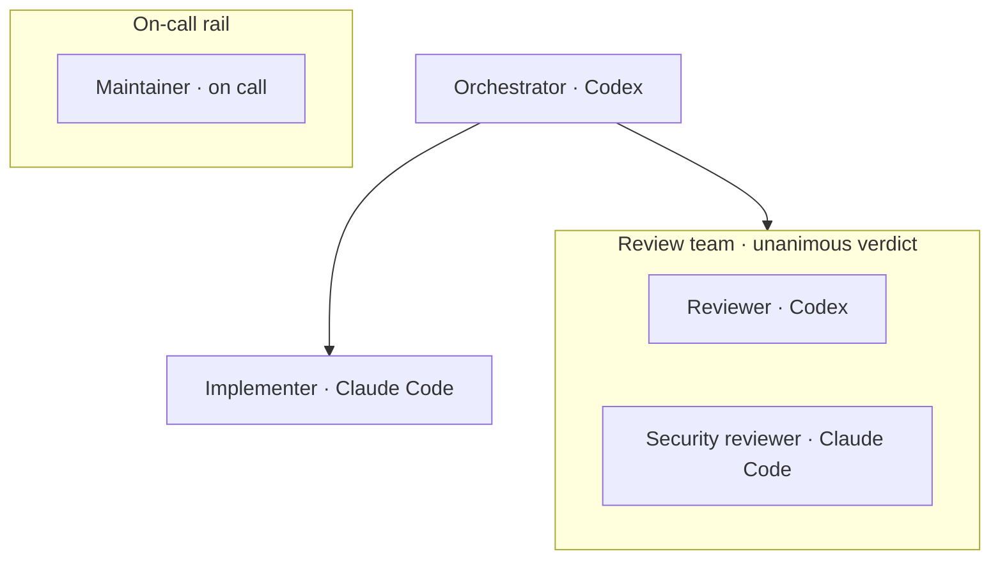

# Product brief

## Vision

Agent Arena lets one developer ask a head agent to coordinate a set of specialized agents, including agents from different model providers. It makes the workflow visible as it runs and keeps work isolated and reversible.

The developer defines intent and policy. Arena creates the graph and agent profiles, starts provider sessions through supported local integrations, routes normalized handoffs, and records what happened.

## Users and jobs

- A solo developer wants a planner, implementer, researcher, and reviewer to work in parallel while seeing their status.
- A team wants repeatable workflows checked into a project without asking every developer to author configuration by hand.
- A reviewer wants to understand which agent proposed a change, what task it received, what it changed, and how to undo it.

## Product objects

- **Arena:** A named workflow configuration, stored as `.arena/<workflow-id>.arena.json`.
- **Agent profile:** A reusable role prompt and capability description generated under `.arena/.agents/<workflow-id>/`.
- **Agent node:** A profile placed in one workflow with a provider, model selector, effort options, and graph level.
- **Reviewer:** An agent role that returns a standard, machine-readable review verdict such as `Approved`, `ChangesRequested`, `Deny`, or `NeedsMoreInformation`.
- **Team:** A composite graph node that runs two or more agents through bounded deliberation and returns one versioned verdict packet.
- **On-call agent:** An agent outside the normal path that Arena invokes for configured events or when the developer requests it.
- **Arena orchestrator:** A project-level permanent on-call control agent, using the user's selected default model and the `arena-orchestrator` skill to manage workflows and handle structured coworker requests.
- **Shared context:** Durable, provenance-bearing knowledge scoped to one workflow and available to its agents across runs.
- **Context entry:** A versioned fact, decision, convention, or finding with evidence, confidence, author, and lifecycle state.
- **Decision router:** A model-free graph block that reads a structured packet field and routes to a configured branch.
- **Local model agent:** An ordinary agent backed by a supported local inference server on the developer's machine.
- **Relationship:** A directed delegation path or an explicit communication link. A two-way link means either agent can address the other through Arena.
- **Run:** One execution of a workflow for a user task.
- **Event:** An ordered record of a state transition, handoff, process result, checkpoint, or integration action.
- **Change:** A diff or commit created by a run and eligible for review, integration, and rollback.

## Experience principles

1. **Build visually, save structurally.** A guided TUI edits a graph; Arena writes validated JSON and agent profiles.
2. **Provider-neutral messages, provider-specific controls.** Shared task and result semantics travel across providers. Model IDs, effort, permissions, and CLI options retain their original provider meaning.
3. **Visible control.** Show agent status, current task, links, worktree, recent messages, and pending review in the live view.
4. **Local ownership.** The developer's machine owns orchestration state, repository access, and provider-approved authentication. A hosted service is not required for the MVP.
5. **Reversible work.** Every accepted code change has a review point and a recorded way to undo it.
6. **No manual config prerequisite.** Users define and maintain workflows in the CLI; the file format is a reviewable implementation detail.

For example, level controls the vertical placement, delegation arrows send work downward, and a team returns one agreed verdict. On-call agents sit in a separate rail and are activated by configured conditions rather than path arrows:

The on-call rail has no normal path arrows. Arena displays an event badge or invocation trace when a trigger fires.

## MVP boundary

The first useful release should support:

- Git repositories on one local machine.
- A guided workflow builder and validator.
- `arena status` to report readiness and adapter-verifiable model/effort choices only for providers required by the selected arena.
- `arena init` to select a default model, load the skill into that provider's supported CLI, and interview the user to create workflows and agents.
- A head agent, multiple worker levels, and explicit peer communication edges.
- Deterministic decision-router blocks that branch on reviewer, team, task, or error results.
- Local model agents that can sit beside provider CLI agents in the same graph.
- A permanent project-level on-call orchestrator that can process agent coworker requests under project policy.
- A standard reviewer result with stable verdict labels.
- Teams of two or more agents that deliberate and return one versioned consensus verdict, or an explicit no-consensus result.
- On-call agents outside the normal path, invoked by configured events or manually.
- Codex CLI and Claude Code adapters, plus a Gemini adapter using an approved API-key or Vertex AI route; never piggyback on Gemini CLI personal OAuth.
- A local inference adapter for supported same-machine backends, with verified model discovery and capability reporting.
- Concurrent, isolated worker worktrees with a controlled integration queue.
- A live terminal graph with run status and recent events.
- A full-terminal A2rena view with an upper-right colored worktree tree, provider-filtered status row, agent graph, and animated packet markers.
- Per-workflow shared context that agents can read and propose updates to across sessions, with provenance and rollback.
- A versioned handoff envelope that preserves provider-specific settings.
- Local run history, checkpoints, diff review, and rollback.

## Out of scope for the first release

- Credential brokerage, pooled subscriptions, account rotation, or generalized API access.
- Cloud-hosted orchestration, multi-user remote workers, and shared teams across machines.
- Claiming semantic equivalence between different providers' model or effort labels.
- Treating a majority vote as consensus or hiding unresolved disagreement in a team result.
- Guessing a worker's provider, model, or reasoning effort when the user has not specified it.
- Treating the shared context store as a transcript or silently presenting stale or uncertain notes as verified facts.
- Automatically merging risky or conflicting changes without a user-configured policy.
- Guaranteeing deterministic replay of model outputs. Replay means replaying recorded orchestration events and inspecting the corresponding outputs and changes.

## Success signals

- A new user can create a useful multi-provider graph through the guided CLI without editing JSON.
- A new user can initialize a project through their selected default model, with all required provider/model/effort choices confirmed explicitly.
- Agents can pass a task from one provider to another without losing scope, file references, or completion status.
- Downstream agents can parse reviewer verdicts and team outcomes without interpreting free-form prose.
- A user can identify every file change's originating task and agent.
- A user can undo an integrated change without erasing later work.
- An unsupported provider setup fails clearly before Arena starts a paid or quota-consuming request.
